# Issue #181 — Leftovers Mundo in the iOS shell, verification shots

Simulator: iPhone 17 (`EDD9B083-63F1-44E6-9A7B-0A6964CC2561`, iOS simulator
runtime from Xcode 27.0 RC; `/Applications/Xcode-27.0-RC.app`).
Xcode: 27.0 (27A266a).
Tested commit: `fa48637b94edcc930514f3cfaee0f46f5ffb920c` (the shots were
taken against that build; this README was added afterwards, with no code
change).

Every state is driven by `KARTA_SEED=<name>` (launched via
`SIMCTL_CHILD_KARTA_SEED=<name> xcrun simctl launch`), one relaunch per
shot, status bar overridden to 9:41. Default size = `xcrun simctl ui <device>
content_size` read back as `large`. AX1 = `xcrun simctl ui <device>
content_size accessibility-medium`, read back as `accessibility-medium`
before the shot, then restored to `large` (read back). Reduce Motion =
`defaults write com.apple.Accessibility ReduceMotionEnabled -bool true` on
the device (read back `1`; restored to `false`, read back `0`).

The cooked recipe in every seed with a Cocinado is the Spanish Tortilla,
cooked yesterday (`leftovers-empty-out-of-window`: 9 days ago). The deck,
pill, note, toast copy, empty state and last-card hint are what the
`KartaPresentation` store returns for the seed catalogue; the card order
and the last Card (Quick Chicken Curry, which has no seed photo) come from
the store, not from the boards' stand-ins.

## Each board next to its shot

| Board | Shot | Seed | Size | State |
|---|---|---|---|---|
| 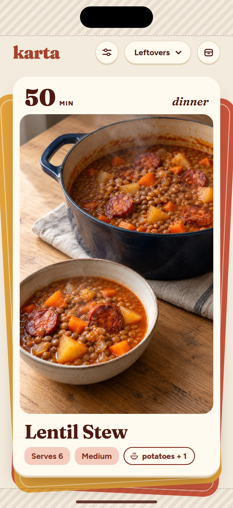 | 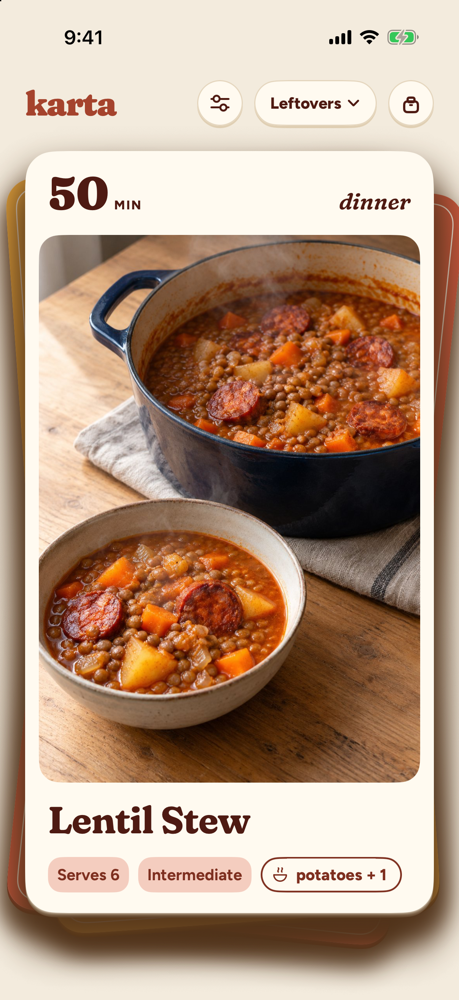 | `leftovers-deck` | default | Leftovers deck, Mundo pill in the header, `potatoes + 1` pill after Serves 6 and the difficulty, in the same row |
| 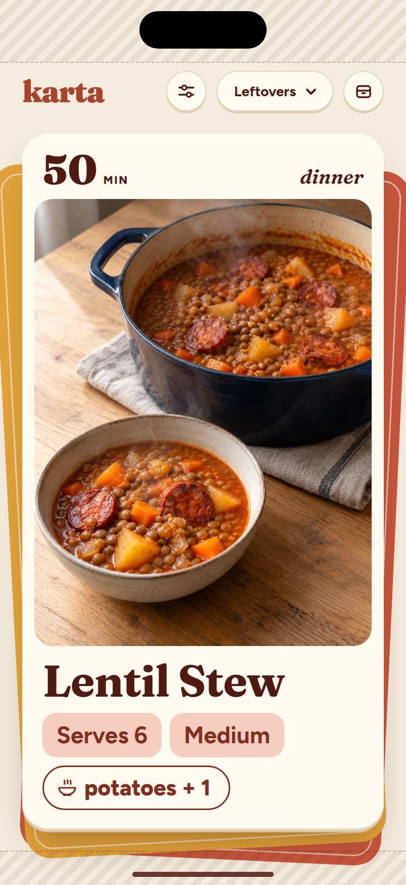 | 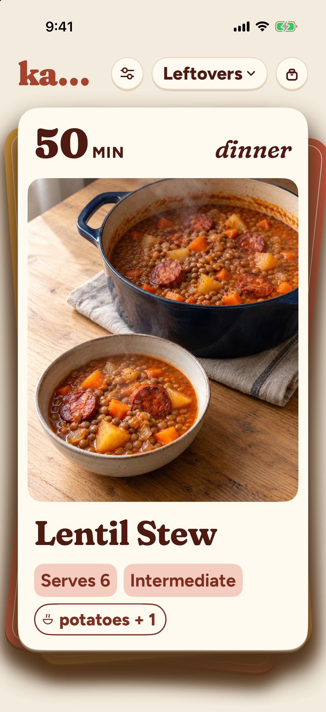 | `leftovers-deck` | AX1 | The pill on its own line 8 pt under the chips |
| 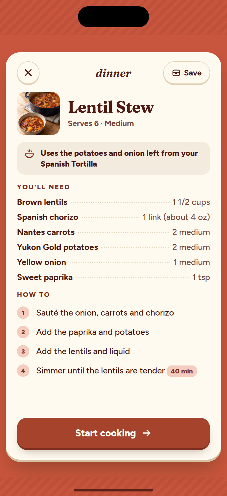 | 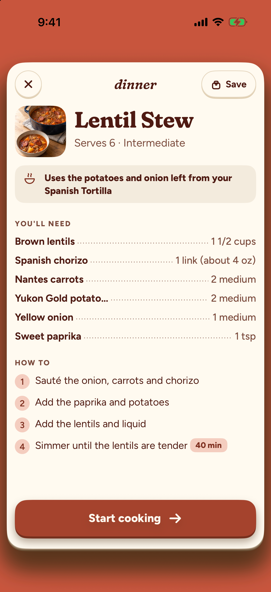 | `leftovers-reverse` | default | Reverse opened from Leftovers: the paper note under the title block |
| 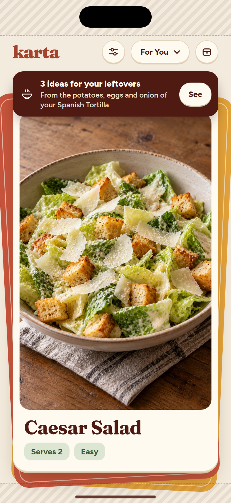 | 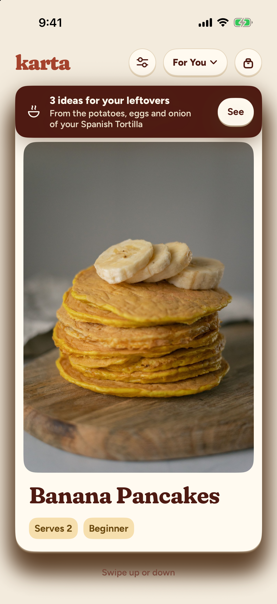 | `leftovers-see-toast` | default | For You after a real explicit Cocinado (start → Pasos → Good → exit): the See toast 12 pt below the header row |
| 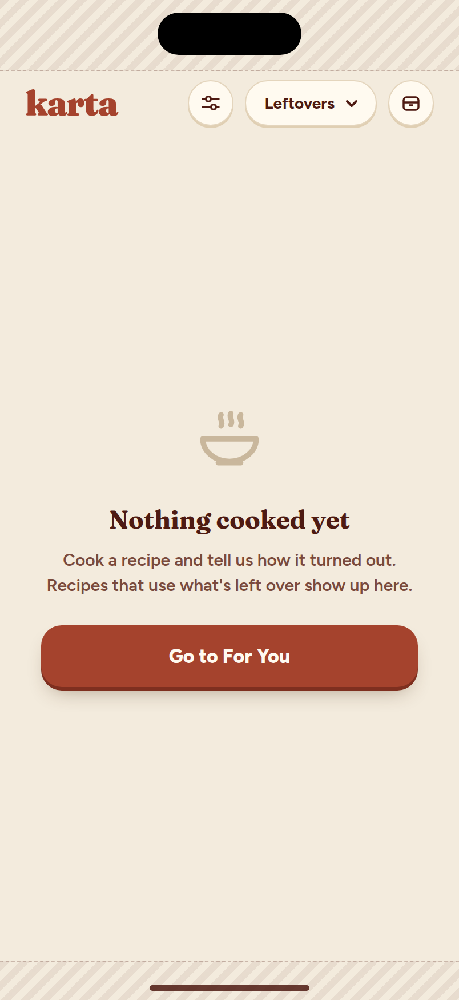 | 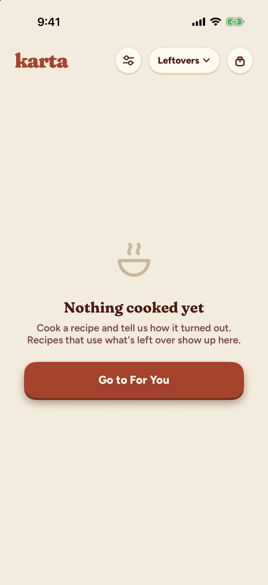 | `leftovers-empty-nothing-cooked` | default | Nothing cooked yet / Go to For You |
| 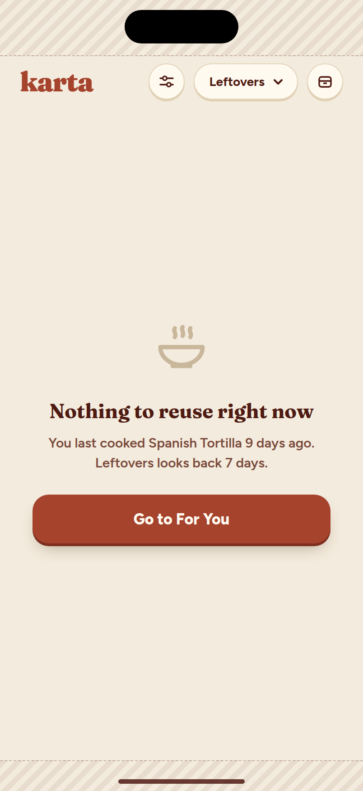 | 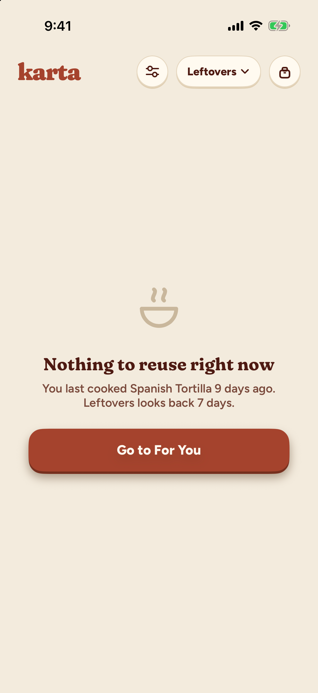 | `leftovers-empty-out-of-window` | default | Nothing to reuse right now, last Cocinado 9 days ago |
|  | 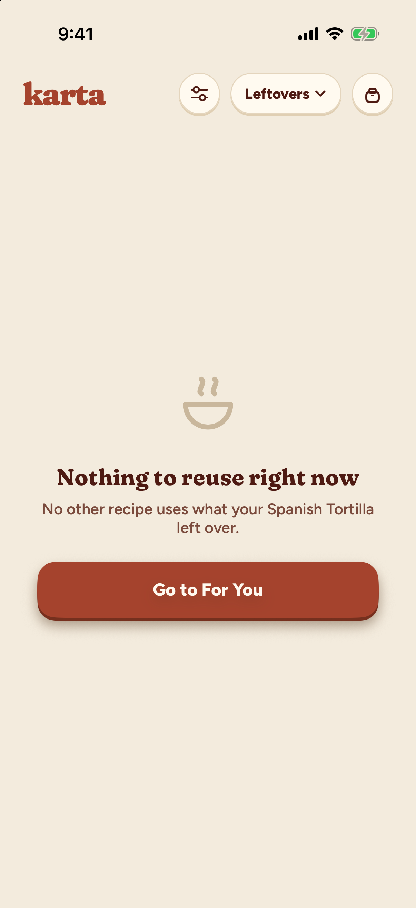 | `leftovers-empty-no-match` | default | Nothing to reuse right now, no other recipe uses what the tortilla left over (the seed drops the three recipes that would) |
| 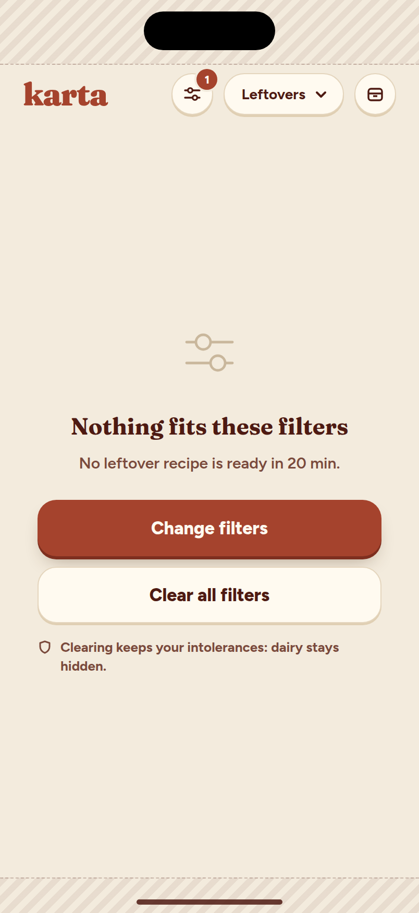 | 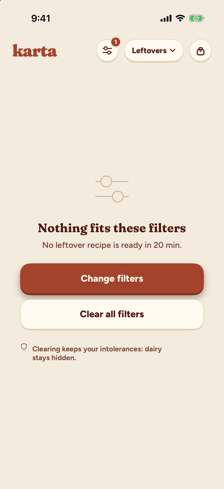 | `leftovers-empty-filters` | default | Nothing fits these filters (Ready in 20 min, dairy intolerance): Change filters / Clear all filters / the kept-intolerances note |
| 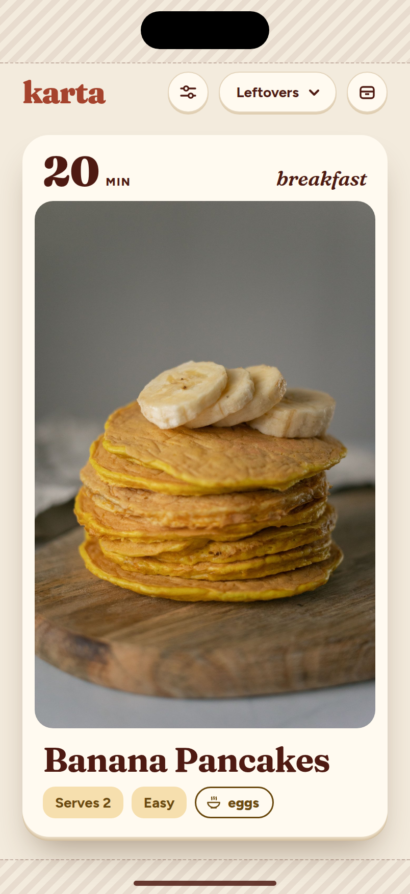 | 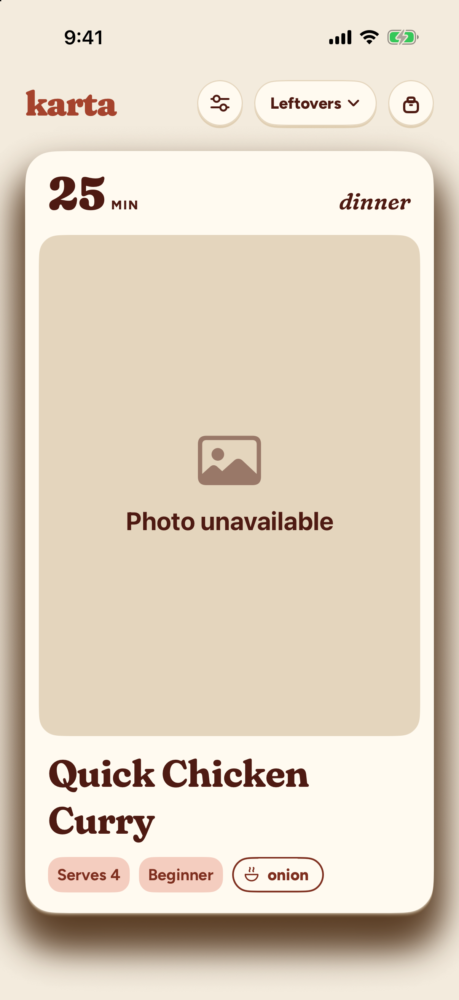 | `leftovers-last-card` | default | Last Card at rest, no cards behind |
| 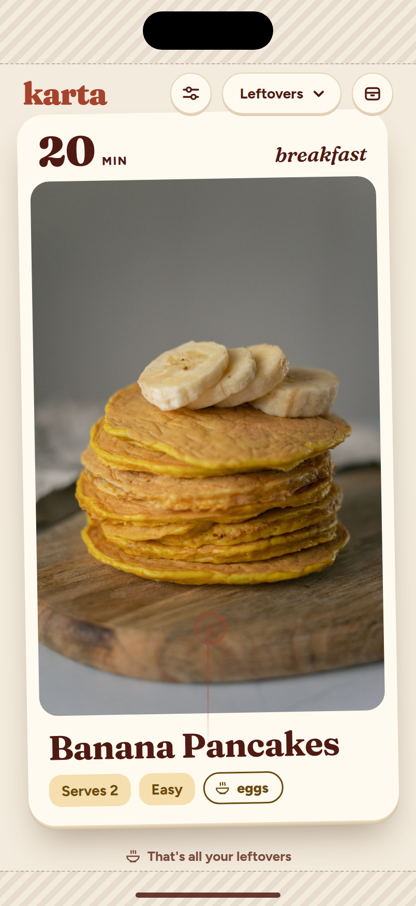 | 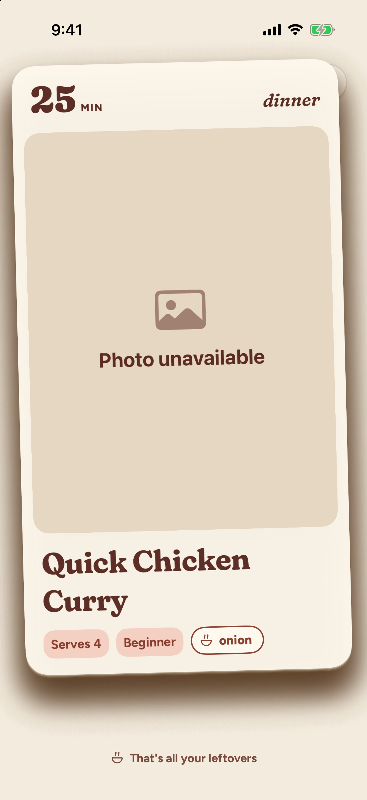 | `leftovers-last-card-bounce` | default | Trying to pass it: the Card held 64 pt up mid-rebound (debug seed), "That's all your leftovers" faded in |

## Extra shots

| Shot | Seed | Size | State |
|---|---|---|---|
| 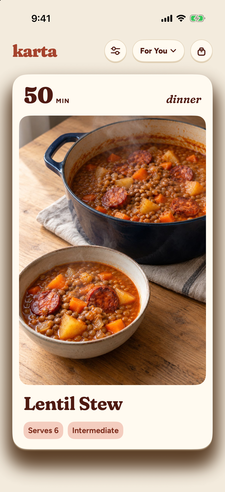 | `foryou-lentil` | default | For You Card of the same recipe (Lentil Stew): same photo height as `01`, no pill |
| 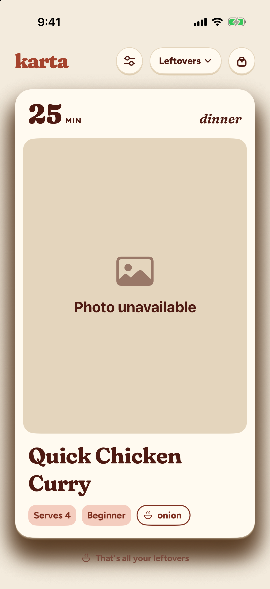 | `leftovers-last-card-hint` | default + Reduce Motion | Released past the last Card under Reduce Motion: no movement, the hint only |
|  | `foryou-last-card` | default | For You's absolute last Card: rebound and "You've seen every recipe" |
